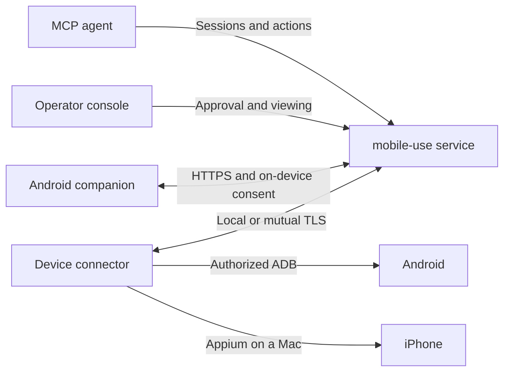
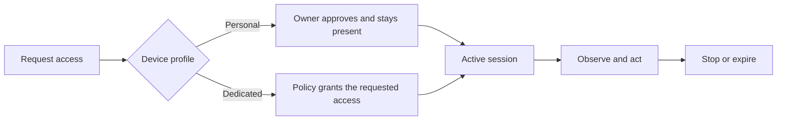

# mobile-use

Control enrolled Android phones and iPhones from an agent or operator console. Run the service on your workstation, or connect authorized device hosts to your own private deployment. Agents connect through MCP or the HTTP API.

[Downloads](https://github.com/UpstandPlatform/mobile-use/releases) · [Deployment guide](docs/operations.md) · [Verification status](docs/verification.md)



## Choose how to connect

| Goal | Install | Device requirements |
| --- | --- | --- |
| Android gestures, app actions, or WebView inspection | Desktop binary and Android SDK Platform Tools | Authorized USB or Wireless Debugging |
| Android screen sharing, camera stills, or microphone clips | Signed companion APK | Android 14+, an HTTPS endpoint the phone trusts, and on-device approval |
| iPhone automation | macOS binary, Xcode, Appium XCUITest, and signed WebDriverAgent | Mac trust and iPhone Developer Mode |
| Private remote control | Container or Helm chart, PostgreSQL, OIDC, and a device connector | Network access between the private service, agent, and connector |

## Install the desktop binary

Download your platform archive from [Releases](https://github.com/UpstandPlatform/mobile-use/releases). Use `amd64` for Intel and AMD PCs and `arm64` for Apple Silicon or other ARM64 systems. This private repository and its packages require GitHub project access. Compare the download to its entry in `SHA256SUMS` using `Get-FileHash -Algorithm SHA256 <archive>` on Windows, `shasum -a 256 <archive>` on macOS, or `sha256sum <archive>` on Linux.

Extract the archive. From its folder, run the following commands. On Windows, substitute `.\mobile-use.exe` for `./mobile-use`.

```sh
./mobile-use version
./mobile-use init
./mobile-use token admin
./mobile-use serve
```

Open [the local console](http://127.0.0.1:8787) and paste the admin token. Keep the daemon running while using the console or an agent. The archive includes the console.

### Control an Android phone

1. Install [Android SDK Platform Tools](https://developer.android.com/tools/releases/platform-tools) and add its directory to `PATH`.
2. Enable Developer options on the phone. For USB, enable USB debugging, connect the cable, and approve the computer’s key. For Wireless Debugging, use `adb pair HOST:PAIRING_PORT` and then `adb connect HOST:DEBUG_PORT` with the addresses shown by Android.
3. Run `adb devices -l` or `./mobile-use doctor`. In the console, select the phone and choose **Enroll this device**. Use a personal profile for a phone whose sessions require owner approval. Use a dedicated profile for unattended, policy-granted devices.
4. Add `local-agent=screen,ui_tree,touch` in **Agent grants** to let the workstation agent inspect and tap. Grant additional capabilities as needed.

For Unicode input and pinch, install `mobile-use-control-<version>.apk` with `adb install -r <apk>` and pass `--android-control-helper` to `serve` or `connector`. For WebRTC viewing, download `scrcpy-server-v4.0` from the [official scrcpy release](https://github.com/Genymobile/scrcpy/releases/tag/v4.0) and pass `--scrcpy-server /path/to/scrcpy-server-v4.0`. The connector verifies the server file before capture.

### Pair the Android companion

Download `mobile-use-companion-<version>.apk` on Android 14 or later. Open it in the phone’s Files app and, if Android prompts you, allow that app to install the package. Official builds use the [Android release certificate](deploy/android-release-certificate.pem).

1. Provide an HTTPS endpoint the phone can reach with a certificate it trusts. For a workstation, set `--companion-listen`, `--companion-origin`, `--companion-cert`, and `--companion-key`. For example, bind `--companion-listen 0.0.0.0:8444` on a trusted LAN and use the HTTPS hostname and port the phone will reach as `--companion-origin`. The certificate must match that hostname.
2. Choose **Pair Android** in the console, then enter the displayed address and code in the phone app before the code expires.
3. Enroll the companion in the console. Keep the app available to review requests. Approve Android’s screen-sharing prompt and each camera or microphone request as needed.
4. Use **Stop** in the app or console to end sharing. **Unpair phone** clears the phone’s credentials and revokes its server pairing when connected.

The companion supports these features without Android debugging. Touch, typing, and app control use the separate ADB enrollment.

### Connect an iPhone

Use a Mac with Xcode and a compatible Appium XCUITest driver. Provision signed WebDriverAgent, start Appium on loopback, and pass `--appium` and `--ios-config` to `serve` or `connector`. The [iPhone setup guide](docs/operations.md#iphone-connector) covers inventory and video. Physical device certification is tracked in the [verification status](docs/verification.md).

## Connect an agent

Register the absolute path to the desktop binary with the `mcp` argument. A workstation install reads its local agent token. To connect to another server, set `MOBILE_USE_URL` and `MOBILE_USE_TOKEN` in the MCP process environment. Use the agent credential for automation and keep the admin credential for the console.

```sh
codex mcp add mobile-use -- /absolute/path/mobile-use mcp
claude mcp add --transport stdio mobile-use -- /absolute/path/mobile-use mcp
```

A network client can use Streamable HTTP at the private `https://<host>/mcp` endpoint. A typical MCP workflow calls `devices_list`, `session_start`, `session_status`, `observe`, `act`, and `session_end`. Use a fresh `frame_id` for screen-relative input and a unique `operation_id` for each action. If an outcome is unknown, observe the phone before retrying.



## Install the private service

Download the deployment bundle and use `ghcr.io/upstandplatform/mobile-use:<version>` or the immutable reference in `oci-image.txt`. Authenticate to GHCR with a credential that has `read:packages` and access to the package. For offline installation, use `docker load -i <oci-linux-archive.tar.gz>` and set `MOBILE_USE_IMAGE` to the image name printed by Docker.

Copy the [environment template](deploy/mobile-use.env.example) to a private file outside the extracted bundle. Configure PostgreSQL, HTTPS certificates, an OIDC issuer and audience, and the connector CA using the [private deployment guide](docs/operations.md#private-service-and-connectors). Then run:

```sh
docker compose --env-file /path/to/mobile-use.env -f deploy/compose.yaml up -d --no-build
```

For Kubernetes, use the Helm release archive. Set `image`, `imagePullSecrets` for private registries, and the TLS and database Secrets described in the same guide.

## Build from source

Use Go 1.26+, Node.js 24+, and, for Android, JDK 17 and Android SDK 36.

```sh
npm --prefix web ci
npm --prefix web run build
go build -o mobile-use ./cmd/mobile-use
go test ./... -count=1
cd android
./gradlew :companion:assembleDebug :companion:lintDebug :control:assembleDebug
```

On Windows, build with `-o mobile-use.exe` and use `gradlew.bat`. See the [release process](docs/release.md) and the [verified platform matrix](docs/verification.md).
